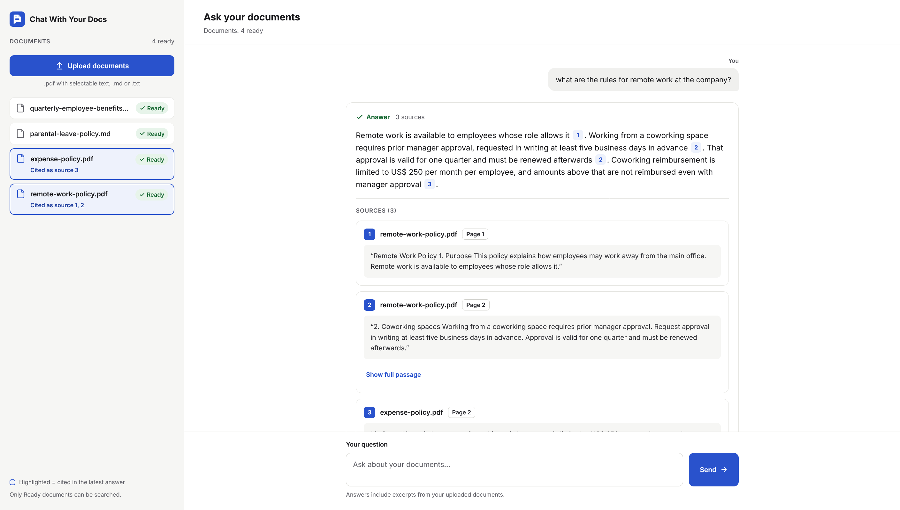
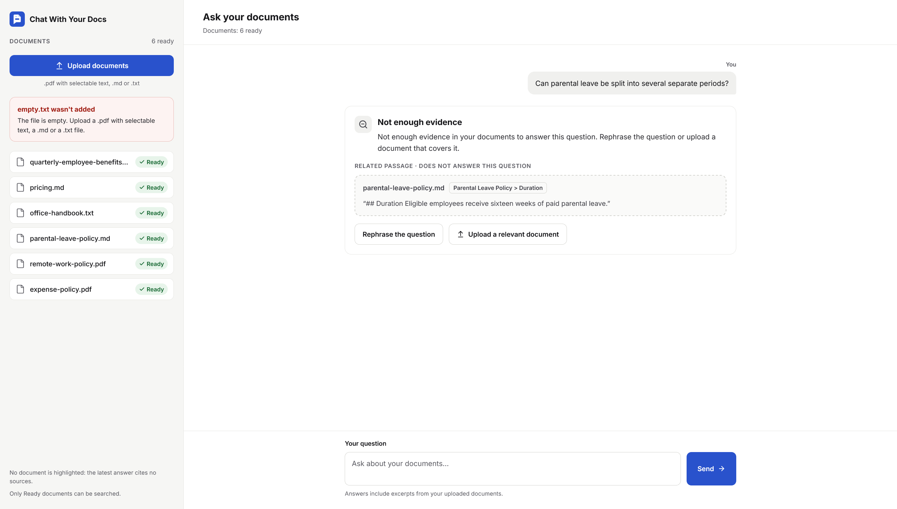
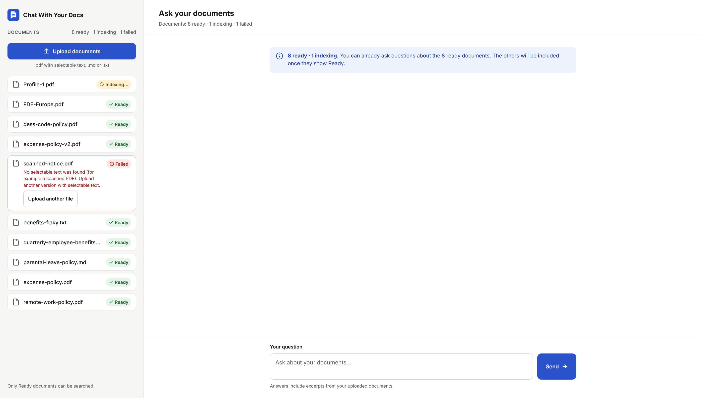
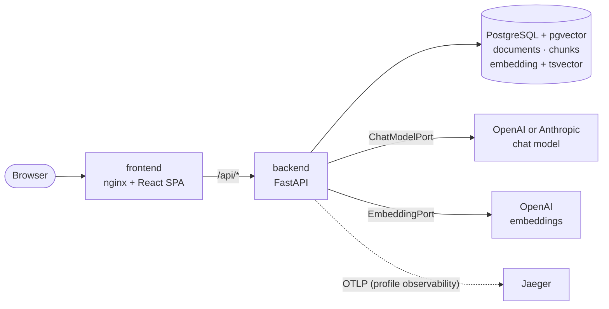
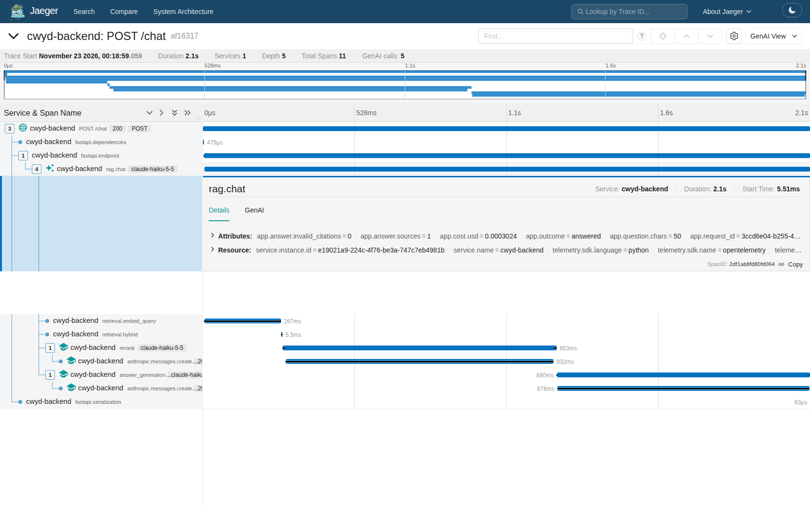
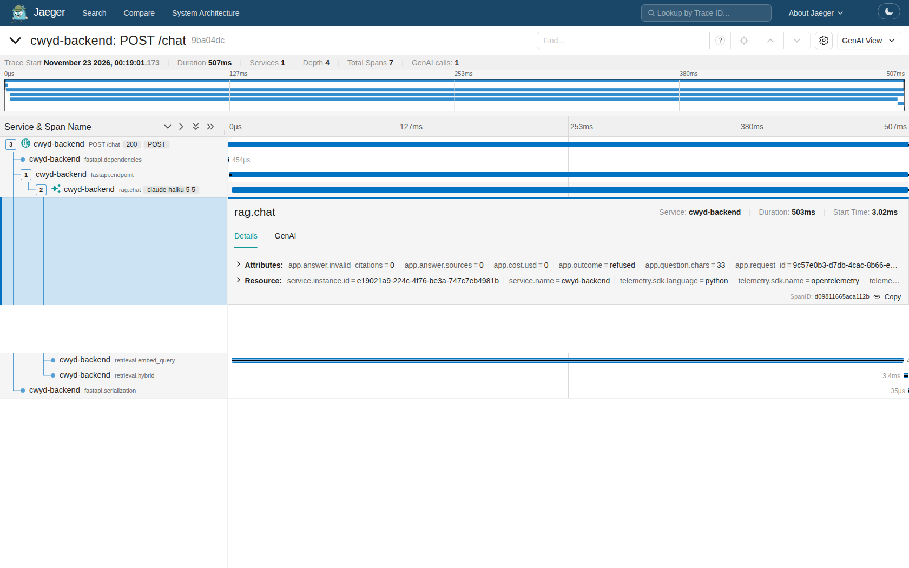
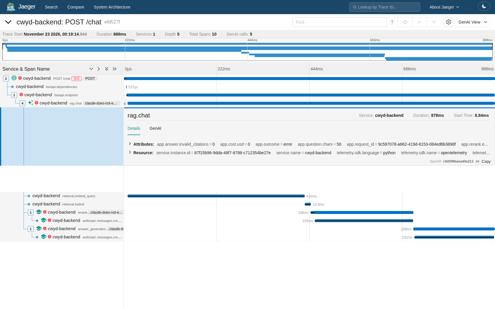
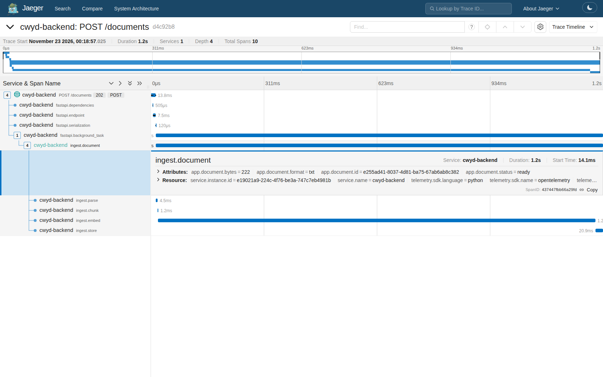

# Chat With Your Docs

Upload documents (.pdf, .md, .txt), ask questions in natural language and get answers grounded
in those documents with verifiable citations, or an explicit "not enough evidence".

Architecture: React SPA → FastAPI → PostgreSQL + pgvector, with the LLM providers behind
ports and adapters. Provider and model names come from configuration, never from code.

## Demo

| Two-source answer | Not enough evidence |
|---|---|
|  |  |

| Indexing, ready and failed documents |
|---|
|  |

Traces of each outcome are under [Observability](#observability).

## Quick setup

Requirements: Docker with Compose v2.24 or newer. Nothing else needs to be installed on the host.

```bash
cp .env.example .env      # then fill in CHAT_MODEL and OPENAI_API_KEY
docker compose up --build --wait
```

`--wait` returns once the three services are healthy:

| Service    | URL                     | Notes                                                        |
| ---------- | ----------------------- | ------------------------------------------------------------ |
| `frontend` | http://localhost:8080   | Vite build served by nginx; `/api/*` is proxied to the API   |
| `backend`  | http://localhost:8000   | FastAPI; interactive docs at `/docs`                         |
| `db`       | `localhost:5432`        | PostgreSQL 17 + pgvector; local-only credentials `cwyd/cwyd` |

| Variable            | Required                       | Purpose                                   |
| ------------------- | ------------------------------ | ----------------------------------------- |
| `CHAT_PROVIDER`     | yes                            | `openai` or `anthropic`                   |
| `CHAT_MODEL`        | yes                            | Chat model name for the selected provider |
| `EMBEDDING_MODEL`   | yes                            | OpenAI embedding model                    |
| `OPENAI_API_KEY`    | yes                            | Embeddings always use OpenAI              |
| `ANTHROPIC_API_KEY` | when `CHAT_PROVIDER=anthropic` | Anthropic chat model                      |

All ports are bound to `127.0.0.1`. Every other setting has a default; the full list is in
[docs/operations.md](docs/operations.md#configuration). Stop with `docker compose down`; add `-v`
to also delete the database volume.

**Try it.** Open http://localhost:8080 and upload `remote-work-policy.pdf`, `expense-policy.pdf`
and `parental-leave-policy.md` from
[`backend/tests/fixtures/documents/`](backend/tests/fixtures/documents/). Once they are Ready, ask:

- *Can I work from a coworking space, and what is the monthly reimbursement limit?* — answered
  from two documents, each with a citation.
- *Can parental leave be split into several separate periods?* — "Not enough evidence": the
  policy does not say, and the app does not guess.

`scripts/smoke.sh http://localhost:8080` runs the same flow from the command line, against any
environment (readiness, upload, two-source answer, insufficient evidence).

## Architecture



The backend follows ports and adapters: `app/domain` and `app/application` (use cases) import no
provider SDK; `app/adapters` holds the OpenAI, Anthropic and PostgreSQL implementations, and
`app/api` is the HTTP edge. The provider is chosen at startup from configuration.

**Upload and indexing (asynchronous).** `POST /documents` validates type, content and size, and
returns the existing document when the same file (SHA-256) was already uploaded. A new document
is stored as `indexing` and the API answers `202`. A background task parses it (pages for PDF,
heading sections for Markdown), splits it into chunks, embeds them and stores each chunk with
its embedding and a full-text vector. The document ends `ready` or `failed` with a reason; the UI
polls until then.

**Question (synchronous).** `POST /chat` embeds the question and runs one SQL query that combines
vector and full-text search with Reciprocal Rank Fusion, limited to the owner's Ready documents.
With no relevant chunk the chat model is not called and the answer is "Not enough evidence".
Otherwise the chunks go into the prompt as labelled, delimited sources within a token budget;
the model returns a structured answer that cites labels, and the backend keeps only the labels it
sent, building each citation (file, page or heading, passage) from the stored chunk.

## Productionizing and scaling on a hyperscaler

Most of the groundwork is already there: two stateless images published by digest after a
vulnerability scan, configuration only through environment variables, liveness and readiness
probes, and a homolog environment on K3s deployed by Argo CD from a GitOps repository
([docs/deploy/homelab.md](docs/deploy/homelab.md)). What changes for a real deployment, using AWS
as the example (GCP and Azure equivalents in parentheses):

- **Runtime.** API and web server on ECS Fargate or EKS (Cloud Run / GKE, Container Apps / AKS)
  behind an ALB with TLS. The API holds no state, so it scales horizontally on CPU and latency.
  Today the backend container runs `alembic upgrade head` on start; with several replicas that
  becomes a one-off migration job that runs before the rollout.
- **Database.** Managed PostgreSQL with pgvector: RDS or Aurora (Cloud SQL / AlloyDB, Azure
  Database for PostgreSQL Flexible Server). Keeping vectors, full-text and metadata in one
  database is what lets retrieval stay a single SQL statement with the owner filter applied
  inside it. The HNSW and GIN indexes are already in the schema; read replicas come before
  any dedicated vector database.
- **Indexing.** This is the part that does not survive production as is. Indexing runs as a
  FastAPI background task in the API process, with the file in memory: a restart loses the job
  (the document is marked failed on the next start) and a large burst competes with questions
  for the same CPU. In production the upload goes to S3 (Cloud Storage, Blob Storage), a message
  goes to SQS (Pub/Sub, Service Bus), and a separate worker service indexes it with retries,
  backoff and a dead-letter queue, scaling on queue depth.
- **LLM access.** The providers' rate limits and latency are the real bottleneck, not the API.
  I would put a gateway in front of them (LiteLLM, or Bedrock / Vertex AI / Azure OpenAI as
  managed endpoints) for provider fallback, per-tenant budgets and virtual keys. The ports
  already isolate the app from the provider, so this is an adapter, not a rewrite.
- **Security and tenancy.** Authentication through OIDC (Cognito, Identity Platform, Entra ID),
  with the `owner_id` that documents and chunks already carry taken from the token instead of the
  default owner. Secrets in Secrets Manager (Secret Manager, Key Vault), not in `.env`. Rate limits
  move from nginx, which only sees the load balancer's address, to the API gateway or WAF per user.
  The API docs are switched off with `API_DOCS_ENABLED=false`.
- **Observability.** The app already exports OTLP; the destination is configuration. An
  OpenTelemetry Collector with tail sampling keeps every error, every refused answer and the
  slow or expensive runs, and sends them to X-Ray / CloudWatch (Cloud Trace, Azure Monitor) or a
  Grafana stack. Alerts on error rate, refusal rate, p95 latency and cost per question, which the
  spans already record.
- **Build vs buy.** Bedrock Knowledge Bases, Vertex AI RAG Engine and Azure AI Search can replace
  the whole ingestion and retrieval pipeline. They are a reasonable choice for a team that does
  not want to own RAG. I kept my own pipeline because the citation guarantees and the evaluation
  depend on controlling chunking, the relevance gate and how sources are built, and that is hard
  to verify through a managed black box.

## RAG and LLM approach

- **LLM.** I considered calling one provider SDK directly, using only LangChain's
  `init_chat_model`, an AI gateway such as LiteLLM, and my own port. I chose a `ChatModelPort` with
  OpenAI and Anthropic adapters, selected by `CHAT_PROVIDER` and `CHAT_MODEL`. The domain never
  imports an SDK, switching provider is configuration, and contract tests run both adapters
  against the same expectations offline. The evaluation ran on Anthropic `claude-haiku-5-5`: a
  small, cheap model is enough when the answer must come from retrieved passages and the output
  is structured. A gateway is the production step, not an MVP need.
- **Embeddings.** OpenAI `text-embedding-3-small` (1536 dimensions), behind an `EmbeddingPort`.
  Anthropic has no embeddings API, so embeddings stay on OpenAI whatever the chat provider is.
  The adapter calls the OpenAI SDK directly instead of LangChain's `OpenAIEmbeddings`, which drops
  the token usage I need for the cost. Changing the model changes the vector size and means
  re-indexing everything, so it is a migration, not a setting.
- **Vector database.** PostgreSQL with pgvector. Alternatives were a dedicated vector database or
  a managed RAG service. One database holds documents, chunks, vectors and the full-text index, so
  hybrid search, the owner filter and the Ready filter run in one query, with no extra service to
  operate and the same engine I would run in the cloud.
- **Orchestration.** LangChain v1 only where it helps: the chat call with structured output, for
  both providers. Retrieval is one SQL statement (vector search, full-text search and Reciprocal
  Rank Fusion), easier to reason about and to trace than a chain. I did not add a query planner:
  free uploads have no taxonomy for it to plan over.
- **Retrieval.** Hybrid, not vector only. Embeddings blur exact terms such as amounts, codes and
  acronyms ("US$ 250"); full-text catches them, and RRF merges both rankings without calibrating
  their scores. An LLM reranker exists behind `RERANK_ENABLED`; the evaluation kept it off.
- **Prompt and context management.** Chunks of 1000 characters with 150 of overlap, each prefixed
  with its file name and page or heading before embedding. Retrieved chunks reach the prompt
  as labelled sources (`S1..Sn`), delimited and escaped, within a 3000-token budget; the answer is
  capped at 800 tokens. The model returns a structured answer that cites labels, never free-form
  references.
- **Guardrails.** The app owns the filters (owner, Ready documents); the model never chooses them.
  A relevance gate runs before the model: with no chunk that matched full-text or reached the
  cosine floor, the answer is "Not enough evidence" and no chat call is made. Citations to labels
  that were not in the prompt are dropped, and an answer with no valid citation becomes
  insufficient evidence, so the app never shows an uncited claim. Document text is treated as
  untrusted data: instructions inside an upload are not followed, and an adversarial set measures
  it. Around it: file type, content and size checks, a PDF page and time budget, and rate limits on
  questions and uploads. Provider failures are errors, never disguised as "not enough evidence".

### Quality

A golden dataset of 13 questions over the fixture documents measures outcome accuracy, retrieval
hit@k, expected-source rank (MRR), correct refusals and citation validity for four configurations,
and a separate set of 8 prompt-injection cases measures resistance to instructions hidden in
uploaded documents. Latest run (`anthropic` / `claude-haiku-5-5`, `text-embedding-3-small`):

| Configuration | Outcome accuracy | MRR | Correct refusals | Citation validity | Injection resistance | p50 latency | Chat cost (13 questions) |
|---|---|---|---|---|---|---|---|
| baseline (defaults) | 100% | 0.85 | 100% | 100% | 100% | 1.1 s | $0.0021 |
| reranker on | 100% | 0.85 | 100% | 100% | 100% | 1.9 s | $0.0033 |
| chunks of 120/20 | 100% | 0.78 | 100% | 89% | 100% | 1.2 s | $0.0021 |
| `MIN_RELEVANCE` 0.45 | 100% | 0.85 | 100% | 100% | 100% | 1.2 s | $0.0020 |

The defaults stay: the reranker adds cost and latency without changing any outcome, smaller
chunks split the evidence, and a stricter relevance floor changes nothing because unrelated
questions are already refused before the chat model is called. Each configuration starts from
the code defaults of the RAG settings, not from the local `.env`, so runs are comparable.

```bash
docker compose --profile eval run --build --rm eval    # with the stack up; reports land in docs/eval/
```

Method, metrics and limits: [docs/eval/README.md](docs/eval/README.md); full numbers:
[docs/eval/comparison.md](docs/eval/comparison.md). Business rules:
[docs/domain-context.md](docs/domain-context.md) (DOM-20, DOM-21, DOM-29).

### Observability

Every question and every indexing job produces an OpenTelemetry trace (exported to Jaeger with the
`observability` Compose profile). `rag.chat` has one child span per real step
(`retrieval.embed_query`, `retrieval.hybrid`, `rerank`, `answer_generation`) and records outcome,
provider, model, tokens and estimated cost; `ingest.document` covers parse, chunk, embed and
store. Span attributes never carry question, prompt, chunk or answer text. Each trace is found by
the `X-Request-ID` the response returns.

| Answered | Refused (not enough evidence) | Failed provider call | Indexing |
|---|---|---|---|
|  |  |  |  |

Setup and the full span list: [docs/operations.md](docs/operations.md#tracing).

## Key technical decisions

- **React + Vite, not Next.js.** One screen, and FastAPI is already the server. SSR, server actions
  and file routing would add decisions without value; Vite gives a static bundle any web server or
  CDN can serve.
- **Ports and adapters for the LLMs.** The decision with the most leverage: provider choice,
  contract tests, cost tracking and a future gateway all hang off the two ports.
- **Hybrid retrieval in the MVP.** The cheapest quality gain, with no new infrastructure. The
  evaluation confirmed it: retrieval hit@k is 100%, the exact-term question included.
- **Measure before adding.** The reranker was built behind a flag and the evaluation decided its
  default (off: same outcomes, about 60% more chat cost and slower). The same run kept the chunk
  size and the relevance floor.
- **Insufficient evidence is a normal answer.** A `200` with a fixed message, not an error, and
  shown without the red reserved for failures. Real failures (provider down, timeout) are errors
  and are never reported as missing evidence.
- **Asynchronous indexing, synchronous questions.** Upload answers `202` and the UI polls; the
  question is a single request. The design handoff kept streaming out of the MVP, and a structured,
  validated answer is simpler to guarantee without it.
- **No login, but a schema ready for it.** Documents and chunks carry `owner_id` with a single
  default owner, so adding users needs no data migration.
- **Formats `.pdf`, `.md`, `.txt`.** PDF keeps page numbers and Markdown keeps headings, which is
  what a citation points to. Scanned PDFs fail with a clear reason; OCR is out of scope.
- **Contract first between backend and frontend.** The OpenAPI schema is exported from FastAPI,
  the TypeScript types and the test mocks are generated from it, and CI fails when either is stale.
- **Docker Compose as the validation path.** One command starts everything, and it uses the same
  images CI scans and publishes.
- **mypy strict over ty.** ty is faster but young; for an evaluated deliverable I preferred the
  mature checker.

## Engineering standards

**Followed**

- Clean Architecture boundaries: domain and use cases import no provider SDK or framework; the
  composition root wires adapters.
- Tests where they pay off, with no coverage target: unit tests for parsing, chunking, prompts,
  the relevance gate and citation building; integration tests against real PostgreSQL with
  pgvector through testcontainers, never SQLite, including hybrid retrieval and fusion; declared
  fakes for the LLM and embeddings; contract tests for both chat adapters; Vitest, Testing Library
  and MSW on the frontend.
- Strict static checks: ruff and mypy strict on the backend, ESLint and `tsc` on the frontend.
- Business rules written down with IDs ([docs/domain-context.md](docs/domain-context.md)) and
  referenced in the code where they apply.
- Privacy by default: no question, prompt, chunk or answer text in logs or span attributes.
- CI on every pull request with one required check, image scanning (Trivy), a dependency audit
  whose exceptions expire, SHA-pinned actions and Dependabot. Protected `main` and `development`,
  squash merges, a CHANGELOG entry per card.
- Evidence per card: runnable `.http` files and screenshots or command output in
  [docs/evidence/](docs/evidence/), and a human run of the Compose stack before a card is done.

**Skipped, on purpose or for time**

- Browser end-to-end tests (Playwright). `scripts/smoke.sh` covers upload to answer over HTTP, and
  the UI has component tests, but no test drives the real browser against the real stack.
- Authentication and multi-tenancy (the schema is ready, the feature is not).
- A coverage threshold: deliberate, it rewards the wrong tests.
- Load and soak testing; the scaling notes above are reasoning, not measurements.
- Streaming answers, OCR and a durable job queue (see the last section).

## How I used AI tools

I used Claude Code throughout, inside a workflow I built for myself (the `dev-workflow` plugin)
and with the Jira cards as the specification:

- **Plan first, with a human checkpoint.** Each card started with `/task CWYD-N`, which reads the
  card and writes a brief (problem, scope, risks, plan). Nothing was implemented until I approved
  it.
- **Who wrote what.** I wrote the core backend (ingestion and answering) myself. For the frontend,
  which is my weakest area, and for cards such as the evaluation harness, tracing, CI, supply
  chain and the homelab manifests, I let the agent write the code after approving its plan, and
  reviewed it.
- **Automated gates before every PR.** `/docs-sync` keeps documentation in step with the diff, a
  definition-of-done checklist is verified item by item, and `/code-review-task` runs lint, types
  and tests and reviews the diff, with its verdict tied to the commit it reviewed.
- **Context, not prompts.** A short `CLAUDE.md` with the non-negotiable constraints, per-component
  `CLAUDE.md` files, path-scoped rules in `.claude/rules/`, and two MCP servers (read-only Postgres
  and Context7 for current library docs).
- **Skills are third-party code.** I preferred skills published by the maintainer of each tool
  and read every one before adopting it. That review found real problems: a skill that ran the
  latest `shadcn` CLI from npm as soon as it loaded, one that pre-approved arbitrary JavaScript
  and documented saving browser cookies, and one that rewrote `PATH` for the whole session. They
  were fixed or rejected ([docs/skills-curation.md](docs/skills-curation.md)).
- **Where I did not delegate.** Product and architecture decisions, the choice of what to
  measure, and reading the evaluation results. Commits carry no AI attribution; this section is
  where its use is disclosed.

## What I would do differently with more time

**Product**

- **Login and conversation history.** Today the conversation lives only in the browser and is
  lost on reload. With users, conversations are stored and can be reopened.
- **Context per user.** Each user gets their own documents. The schema already carries `owner_id`
  on documents and chunks, and retrieval already filters by it; the work is authentication and
  taking the owner from the token instead of the single default owner.
- **Control over the context.** Remove a document, or leave it out of the search without deleting
  it. Today a document can only be added.
- **Document history.** What was uploaded, replaced or removed, and when, so it is clear which
  documents an answer could have used.
- **Sharing.** Share a conversation, or a whole document collection, with another user so they
  can build on the same context instead of uploading everything again.
- **Usage and performance views.** Collection size (documents, chunks, tokens indexed) and the
  metrics the traces already record (latency per step, answered vs. refused, cost per question)
  shown in the app, not only in Jaeger or Grafana.

**Engineering**

- **A durable indexing pipeline.** Object storage, a queue and separate workers instead of
  background tasks in the API process. It is the first thing to change before real traffic.
- **Streaming answers.** Server-sent events for the text, with the sources sent as a final,
  separate event once they are validated: perceived latency matters in a chat UI, but citations
  must not be shown before they are checked.
- **A larger and harder evaluation.** Thirteen questions over small, fictitious documents prove
  the mechanics, not the quality on real corpora. I would add real documents, longer ones and
  near-duplicates, and measure a vector-only baseline, which I never isolated.
- **Better retrieval where the evaluation shows a need:** a cross-encoder or managed reranker,
  MMR for diverse sources, and detection of conflicting versions of the same policy.
- **Browser end-to-end tests** for the two main flows, and OCR for scanned PDFs.
- **An LLM gateway and tail sampling** in the observability pipeline, as described above.

## Further reading

| Topic | Where |
|---|---|
| Configuration, API behaviour, tracing, security headers, rate limits, troubleshooting | [docs/operations.md](docs/operations.md) |
| Dev container, tests, API contract, design system, CI and images, repository layout | [docs/development.md](docs/development.md) |
| Business rules (DOM-xx) | [docs/domain-context.md](docs/domain-context.md) |
| RAG evaluation | [docs/eval/](docs/eval/README.md) |
| Homelab deploy (K3s + Argo CD) | [docs/deploy/homelab.md](docs/deploy/homelab.md) · [evidence](docs/evidence/CWYD-7-homelab.md) |
| Evidence per card (screenshots, command output) | [docs/evidence/](docs/evidence/) · requests in [docs/http/](docs/http/) |
| AI skills curation | [docs/skills-curation.md](docs/skills-curation.md) |
| Change history | [CHANGELOG.md](CHANGELOG.md) |
