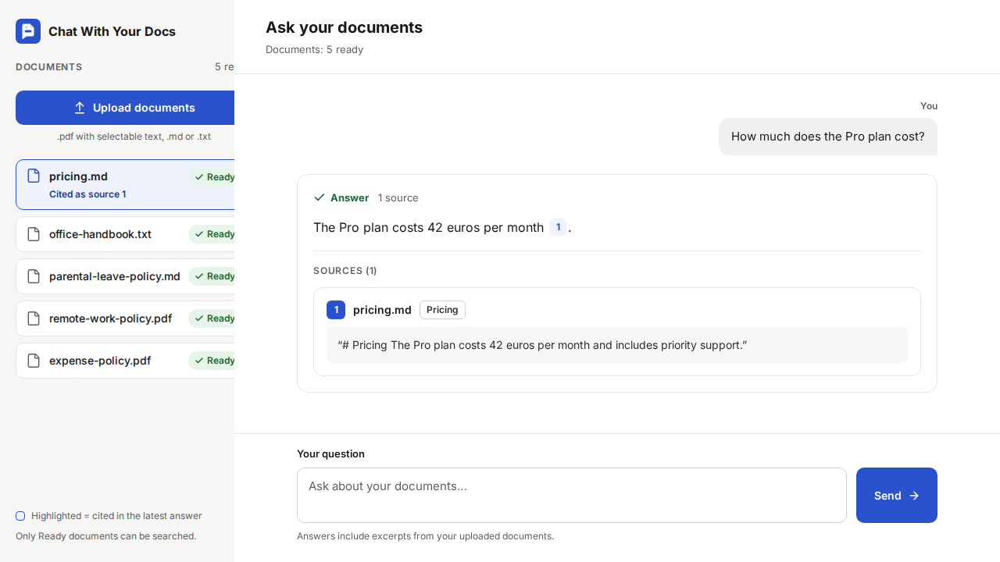

# CWYD-14 — Security headers and API docs switch

Evidence for the card's acceptance criteria. Outputs are verbatim (filtered to the relevant
headers with `grep -iE`); nothing is mocked.

Environment: 2026-11-22, Docker 29.9.2, Docker Compose v5.6.1, branch
`feat/CWYD-14-harden-http-surface`, stack started with `docker compose up --build --wait`.

## Security headers on the web server

`curl -s -D - -o /dev/null` against `http://localhost:8080`, one request per kind of response
nginx produces: SPA page, hashed asset, a 404 from the `/assets/` location, the API proxy and
nginx's own 413.

```text
### GET /
HTTP/1.1 200 OK
X-Content-Type-Options: nosniff
Referrer-Policy: strict-origin-when-cross-origin
X-Frame-Options: DENY
Content-Security-Policy: default-src 'self'; script-src 'self'; style-src 'self'; img-src 'self' data:; font-src 'self'; connect-src 'self'; object-src 'none'; base-uri 'self'; form-action 'self'; frame-ancestors 'none'
### GET /assets/index-DEQPlZ9X.js
HTTP/1.1 200 OK
Cache-Control: public, max-age=31536000, immutable
X-Content-Type-Options: nosniff
Referrer-Policy: strict-origin-when-cross-origin
X-Frame-Options: DENY
Content-Security-Policy: default-src 'self'; script-src 'self'; style-src 'self'; img-src 'self' data:; font-src 'self'; connect-src 'self'; object-src 'none'; base-uri 'self'; form-action 'self'; frame-ancestors 'none'
### GET /assets/missing.js
HTTP/1.1 404 Not Found
X-Content-Type-Options: nosniff
Referrer-Policy: strict-origin-when-cross-origin
X-Frame-Options: DENY
Content-Security-Policy: default-src 'self'; script-src 'self'; style-src 'self'; img-src 'self' data:; font-src 'self'; connect-src 'self'; object-src 'none'; base-uri 'self'; form-action 'self'; frame-ancestors 'none'
### GET /api/health
HTTP/1.1 200 OK
X-Content-Type-Options: nosniff
Referrer-Policy: strict-origin-when-cross-origin
X-Frame-Options: DENY
### GET /api/openapi.json
HTTP/1.1 200 OK
X-Content-Type-Options: nosniff
Referrer-Policy: strict-origin-when-cross-origin
X-Frame-Options: DENY
### POST /api/documents (12 MB)
HTTP/1.1 413 Request Entity Too Large
X-Content-Type-Options: nosniff
Referrer-Policy: strict-origin-when-cross-origin
X-Frame-Options: DENY
```

- The asset keeps its `Cache-Control` and also gets the security headers: `add_header_inherit
  merge` (nginx 1.29.3+, the image runs 1.31.7) keeps the server-level headers in a location that
  declares its own.
- The 404 and 413 carry the headers thanks to `always`.
- Responses under `/api/`, including nginx's own 413 JSON for an upload, carry no CSP: the `map`
  on `$uri` returns an empty value there, and nginx does not send an empty header.

## API docs switch

Default (`API_DOCS_ENABLED` unset, so `true`), on the running backend:

```text
API_DOCS_ENABLED=true  GET /docs          → 200
API_DOCS_ENABLED=true  GET /redoc         → 200
API_DOCS_ENABLED=true  GET /openapi.json  → 200
```

Switch off: the same backend image, started with `API_DOCS_ENABLED=false` through
`docker compose run --rm --no-deps -e API_DOCS_ENABLED=false --entrypoint sh backend`, with
uvicorn and the requests both inside the container:

```text
API_DOCS_ENABLED=false GET /health        -> 200
API_DOCS_ENABLED=false GET /docs          -> 404
API_DOCS_ENABLED=false GET /redoc         -> 404
API_DOCS_ENABLED=false GET /openapi.json  -> 404
```

Both states are also covered by `backend/tests/unit/test_api_docs_toggle.py`, which additionally
checks that the flag is read from the environment at import time and that `app.openapi()` (used
by `scripts/export_openapi.py`) still builds the schema with the routes off.

## The app under the CSP

Headless Chromium (Playwright) on `http://localhost:8080`, with a listener on
`securitypolicyviolation` and on console errors: load the page, upload `pricing.md`, wait for it
to be Ready, ask "How much does the Pro plan cost?". Result:

```text
{
 "violations": [],
 "errors": [],
 "title": "Chat With Your Docs"
}
```

The answer rendered with its citation (`CWYD-14/answer-under-csp.png`):


