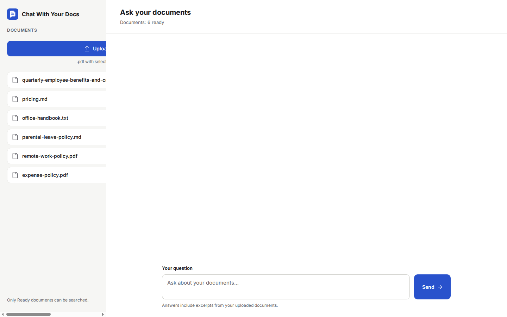
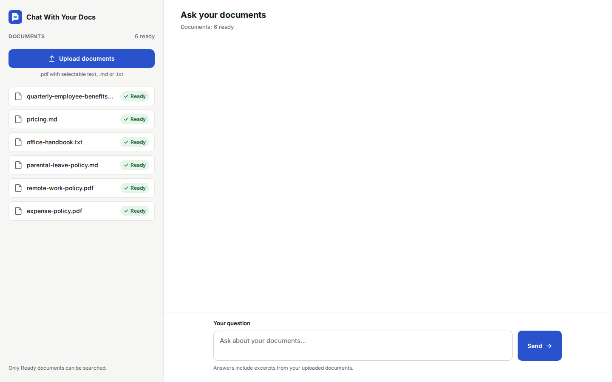

# CWYD-29 — sidebar overflow with long file names

Found on the homolog deploy (CWYD-7). Screenshots from `chrome-headless-shell` against
`docker compose up` with six documents, one named
`quarterly-employee-benefits-and-cafeteria-menu-overview-2026.txt`.

**Cause.** A flex item never shrinks below its min-content width, and a `truncate` file name
still counts its full length there. The `<aside>` (inside a scroll container from `md` up) and
the sidebar column (no scroll container below `md`) had no `min-w-0`, so the longest name set the
sidebar width: horizontal scroll, clipped counter, button and chips, and no ellipsis.

**Fix.** `min-w-0` on both, and the column basis set to the handoff width (`24rem`: the handoff's
`300px` basis grew to ~384px around its file names, see `_docs/design/3-answer-two-sources.png`).

| Before (1440 px) | After (1440 px) |
|---|---|
|  |  |

After at 1024, 800 and 390 px (stacked layout): [1024](CWYD-29/after-1024.png),
[800](CWYD-29/after-800.png), [390](CWYD-29/after-390.png). Normal names fit; the long one
ends in "…" with the full name in its tooltip; no horizontal scroll at any width.

`npm run lint`, `npm run typecheck`, `npm test` (66 passed) and `npm run tokens:audit`
(0 drift, 0 hardcoded) pass. The new Vitest test guards the tooltip (full name next to the
status); jsdom does no layout, so the screenshots above guard the fit until Playwright E2E
lands (CWYD-8).
